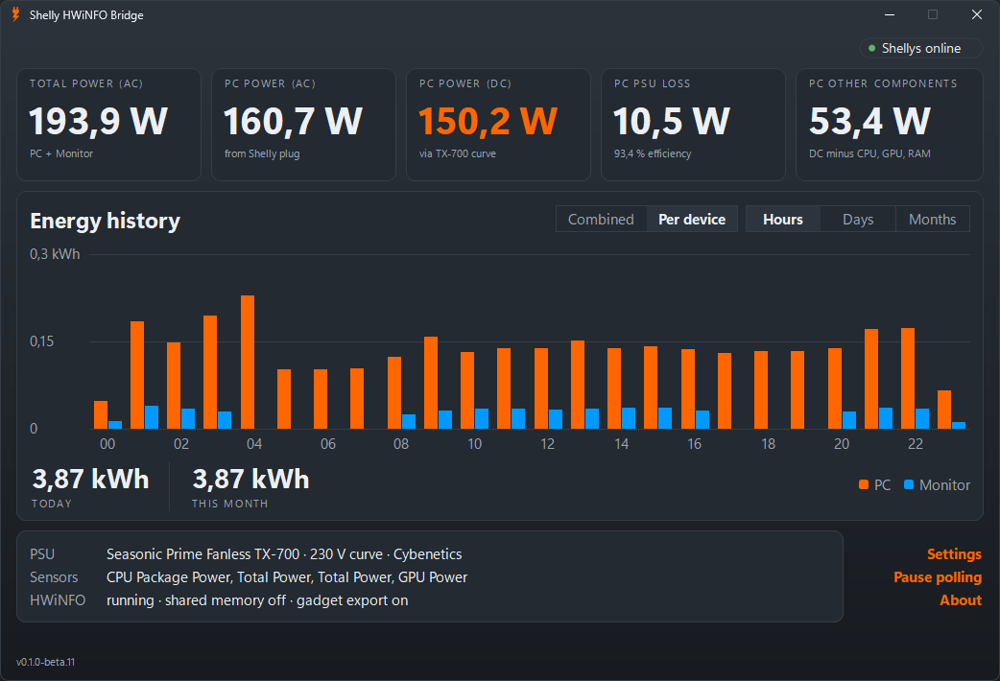
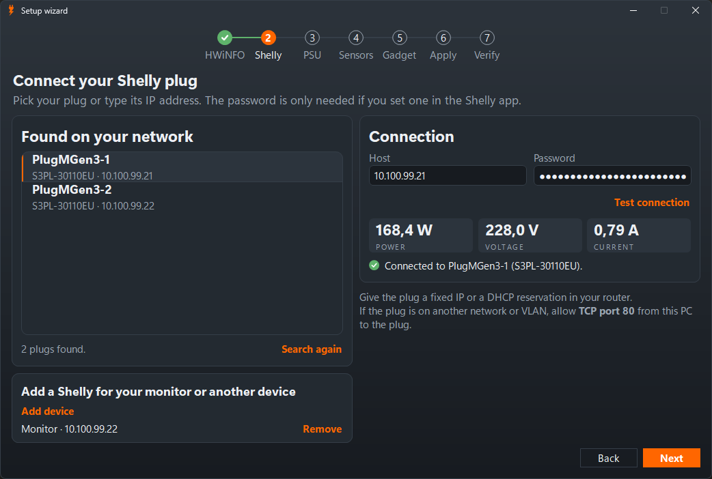
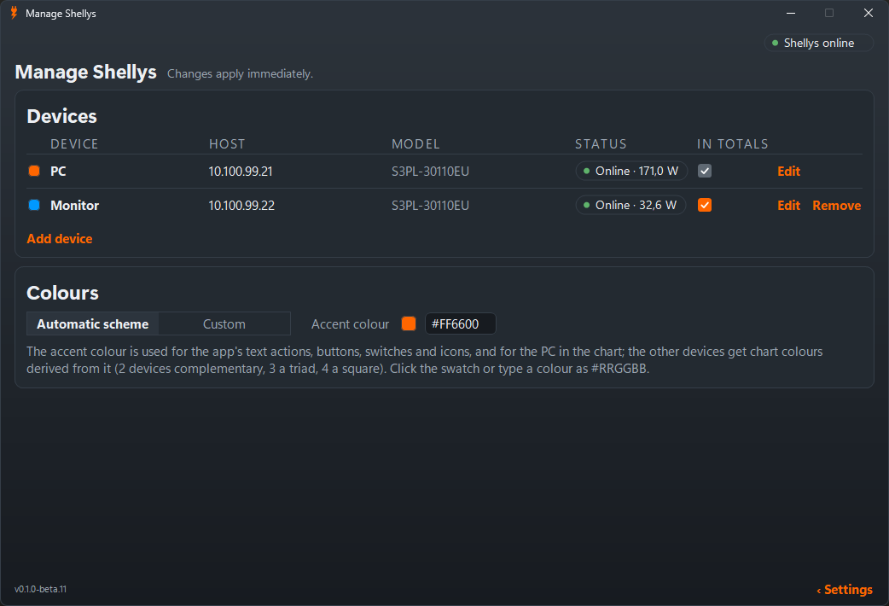
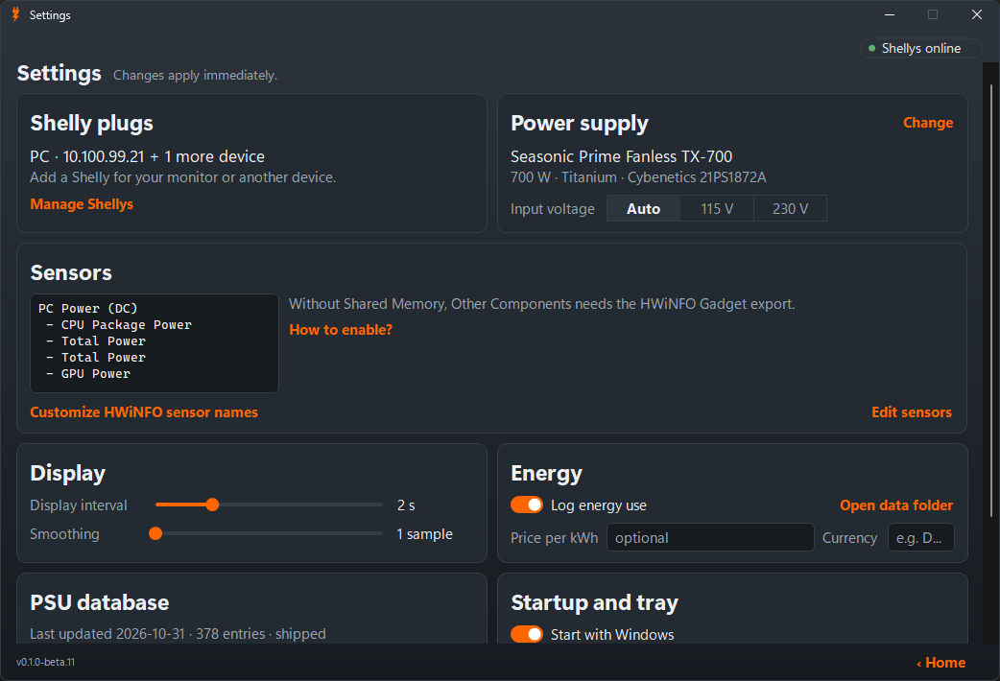
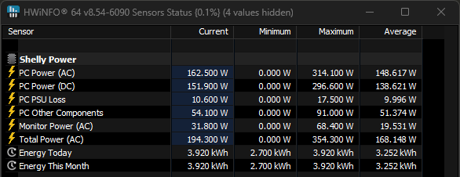

# Shelly HWiNFO Bridge

Shelly HWiNFO Bridge is a small Windows tray app that reads your PC's wall power from a Shelly smart plug and
publishes it to [HWiNFO](https://www.hwinfo.com/) as custom sensors: AC power, estimated DC power through your PSU's
measured efficiency curve, PSU loss, "Other Components" (DC minus the CPU, GPU and RAM power HWiNFO already reports,
as the median over 10 s), Total Power (AC) across extra plugs such as one for your monitor, and Energy Today /
Energy This Month. The sensors appear in HWiNFO in the group `HKCU\Software\HWiNFO64\Sensors\Custom\Shelly Power`.

## Why

HWiNFO cannot report total system power unless the PSU itself has a digital interface. A cheap Shelly plug plus the
PSU's published efficiency curve gives the same insight for any PSU.

## Screenshots

<table>
  <tr>
    <td></td>
    <td></td>
  </tr>
  <tr>
    <td></td>
    <td></td>
  </tr>
  <tr>
    <td colspan="2"></td>
  </tr>
</table>

## Install

Download `ShellyHwinfoBridge-v<version>-setup.exe` from the [Releases page](https://github.com/eksdeexD/ShellyHwinfoBridge/releases).
It installs into Program Files and upgrades an existing install in place. The `-win-x64.zip` is a portable
alternative. The setup wizard opens on first start.

With winget, once the package is accepted into the winget repository:

```powershell
winget install Zapador.ShellyHwinfoBridge
```

Requirements:

- Windows 10 or 11, x64. No .NET install is needed (the app is self-contained).
- HWiNFO64. The free version is fine: it turns Shared Memory off after 12 hours, and the app then uses HWiNFO's
  gadget export, which the wizard helps you set up.
- A Gen2 or Gen3 Shelly with power metering, such as a Plug S Gen3, Plug M Gen3, Plus Plug S or PM Mini. Gen1
  devices are not supported. Up to 4 Shellys in total.

## How it works

The plug reports AC watts every second. The app converts AC to an estimated DC figure through the PSU's efficiency
curve (115 V or 230 V, picked from the voltage the plug measures) and writes the sensors to the registry; HWiNFO
shows them after a restart of HWiNFO. Energy comes from the plug's own counter and is logged hourly to
`%APPDATA%\ShellyHwinfoBridge\energy`.

The PSU database holds curves from Cybenetics evaluation reports for 378 units, and more will be added. A PSU that
is missing can use a generic 80 Plus curve or a custom curve. "Check for update" in Settings downloads a newer
database from this repository.

## Feedback

Bug reports and suggestions: the [Issues page](https://github.com/eksdeexD/ShellyHwinfoBridge/issues) or
zapador@zapador.net.

## Building

Requires the .NET 8 SDK.

```powershell
dotnet build -c Release
dotnet test -c Release
dotnet publish src/ShellyHwinfoBridge/ShellyHwinfoBridge.csproj -c Release -o publish
```

The publish step produces a self-contained, single-file x64 `ShellyHwinfoBridge.exe`; the release workflow builds
the installer from it with Inno Setup. [`tools/cybenetics-import`](tools/cybenetics-import/README.md) is a
maintainer tool that turns a Cybenetics report PDF into a database entry.

## PSU data attribution

The PSU efficiency curves in `psu-database.json` are test results provided by [Cybenetics](https://www.cybenetics.com/),
used with their written permission. Each entry links to the original report and names the input voltage of the
curve (115 V or 230 V); the results are from the sample Cybenetics tested. PSUs not in the database can use a generic
curve derived from the 80 Plus minimum requirements (approximate, least accurate at low load) or a manually entered
curve.

## License

The source code is licensed under [MIT](LICENSE). Copyright (c) 2026 Zapador.

The Cybenetics data in `psu-database.json` is not covered by the MIT licence. It remains under Cybenetics' conditions,
see [PSU-DATA-NOTICE.md](PSU-DATA-NOTICE.md).
